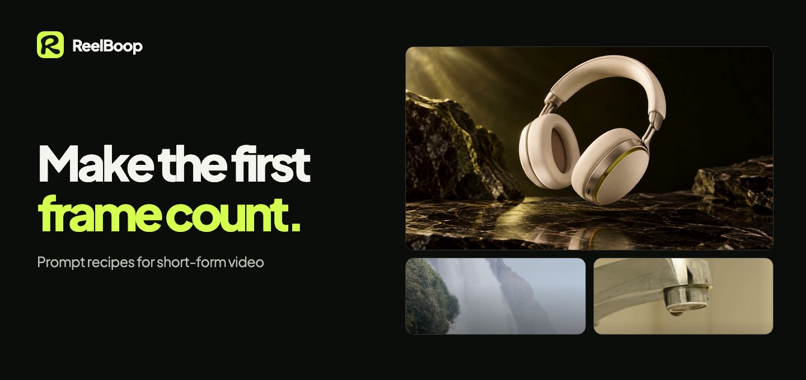

  

# Viral Video Prompts

A ReelBoop field guide for short-form video. Pick a shot, copy the prompt, and adapt it to your own footage or reference image. Each recipe tells you what to check before you use the clip.

[Prompt library](#prompt-library) · [Published examples](#published-examples) · [Prompting workflow](guides/prompt-workflow.md) · [Open ReelBoop Photo to Video](https://reelboop.com/create/photo-to-video?utm_source=github&utm_medium=repository&utm_campaign=viral_video_prompts)

## Start with a shot

1. Choose the moment the viewer should understand in the first frame.
2. Pick a recipe that matches your input. Set duration and aspect ratio in your tool.
3. Render one short clip, check it against the recipe, and change one detail before trying again.

## Prompt library

These are original draft prompts you can adapt to your model. Each recipe gives a mode, a practical starting length, editable variables, and a review check. Published ReelBoop work appears in the next section.

| Shot | Input | What it gives you |
| --- | --- | --- |
| [Drawer reveal](prompts/product-and-ads.md#drawer-reveal) | Product photo | A single reveal that lands on a readable packshot |
| [Material light pass](prompts/product-and-ads.md#material-light-pass) | Product photo | A close-up that makes the finish visible |
| [Overhead layout reveal](prompts/product-and-ads.md#overhead-layout-reveal) | Product photo | Negative space for a headline added in the edit |
| [Doorway match cut](prompts/transitions-and-loops.md#doorway-match-cut) | Two reference images | Two short shots with a shared cut point |
| [Foreground wipe](prompts/transitions-and-loops.md#foreground-wipe) | One reference per shot | A clean transition hidden by foreground motion |
| [Return-to-start loop](prompts/transitions-and-loops.md#return-to-start-loop) | Still image | A simple motion with a deliberate return pose |
| [Pattern break to proof](prompts/hooks-and-story.md#pattern-break-to-proof) | Text or footage | A striking opener that cuts to a concrete detail |
| [Reaction and reveal](prompts/hooks-and-story.md#reaction-and-reveal) | Two separate shots | A setup, payoff, and readable reaction |
| [Three-beat service ad](prompts/hooks-and-story.md#three-beat-service-ad) | Footage or generated inserts | A short ad from hook to problem to call to action |

## Published examples

| Example | What to take from it |
| --- | --- |
| [Stock footage into a 12-second ad](cases/stock-footage-ad.md) | A real edit with shot timings, a phone check, and a downloadable FFmpeg recipe. |
| [One clear product shot](cases/one-clear-product-shot.md) | ReelBoop’s product-film example and a practical check for shape, finish, and label drift. |
| [Bandit duet role blocking](cases/bandit-duet.md) | A published template that makes it clear who leads, who supports, and when the focus changes. |

For more on timing, image-to-video motion, audio cues, and validation, see the [prompting workflow and sources](guides/prompt-workflow.md).

**Contributing.** Share the input type, prompt, tool or model if known, and what you observed. Include a result link you have permission to share. Mark it as a draft recipe until there is a render to review.
